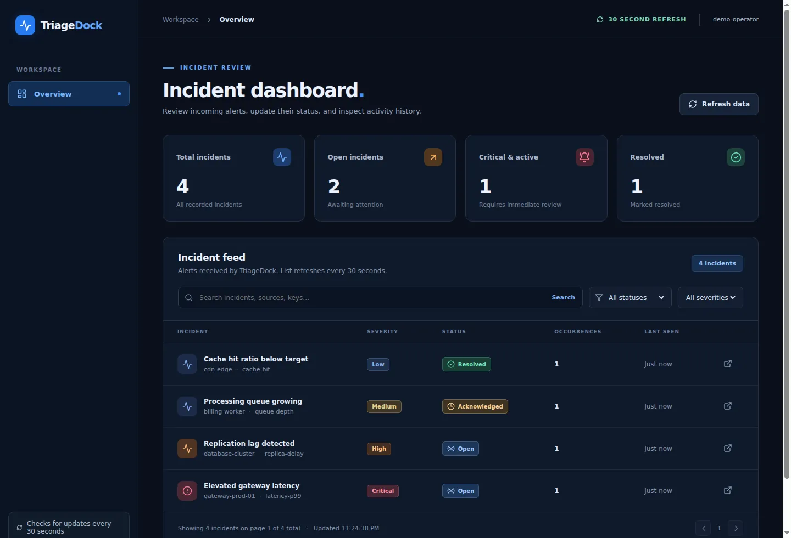

# TriageDock

**Receive monitoring alerts, track incidents, and record operator actions.**

TriageDock accepts alerts from monitoring tools and groups repeated reports under the same incident. Operators can review the incident history, acknowledge incidents, and mark them resolved in a browser. An optional worker sends notifications to a configured HTTPS webhook.

The stack is **Python 3.13, Django 6.1, Django REST Framework, PostgreSQL, Redis, Celery, React 19, and TypeScript**.



*Actual browser screenshot captured by the CI walkthrough from a local Docker Compose environment using synthetic demo incidents. No production data.*

The browser uses Django session authentication. All authenticated users can read incidents; only users granted incident-operator permission can acknowledge or resolve. The dashboard hides mutation controls for readers. The incident list supports search and filters by status and severity, with updates requested every 30 seconds while the page is visible. An alert with the same `source` and `external_key` increments the existing incident's occurrence count. A new report for a resolved incident reopens it. Repeated alerts cannot automatically reduce the severity of an active incident.

## Engineering decisions

- **One incident identity:** A unique fingerprint derived from `source` and `external_key` groups repeated alerts without creating duplicate incident records. Database transactions and uniqueness constraints protect the stored state.
- **Auditable state changes:** Acknowledge, resolve, repeat and reopen operations create timestamped events. An acknowledged incident stays acknowledged when another identical alert arrives; a resolved one reopens.
- **Delivery failure is visible:** Notifications go through a PostgreSQL outbox to a Celery worker. A receiver can receive a duplicate or no delivery after retries are exhausted; the UI shows delivery attempts.
- **Deliberate scope:** Browser sessions, CSRF protection, an API key for monitor intake, local PostgreSQL and Redis services. No multi-tenant authorization, external deployment, or high-scale paging claim.

See the [engineering walkthrough](docs/PROJECT_OVERVIEW.md) for the complete flow and verification details.

## Quick start (Docker Compose)

### Operator access and alert credentials

The application differentiates **readers** from **operators**. A signed-in reader can inspect incidents, but status changes require the Django `incidents.change_incident` permission. Superusers already have it. To grant it to an existing active user:

```powershell
docker compose exec web python manage.py grant_operator your-username
```

For independent monitors, generate a high-entropy source-scoped ingestion key (the token is printed once):

```powershell
docker compose exec web python manage.py create_ingest_credential --label host-one --source host-one
```

Store that key outside the repository and send it using `X-TriageDock-Key`. For rotation, create a replacement using a new label, update the monitor, then revoke the old label. Revoke it with `docker compose exec web python manage.py revoke_ingest_credential host-one`. Source-scoped credentials cannot impersonate another source. The original environment key remains supported for existing integrations; set `INGEST_SHARED_KEY_ENABLED=0` after migrating to source-scoped keys to disable it.


Requires Docker Engine + Compose plugin.

1. Copy `.env.example` to `.env`; replace **all three** sample secrets (`DJANGO_SECRET_KEY`, `INGEST_API_KEY`, `POSTGRES_PASSWORD`). Do not commit `.env`.
2. Run `docker compose up --build -d`.
3. Run `docker compose exec web python manage.py createsuperuser` and create an operator.
4. Visit **http://localhost:8000** and sign in.
5. Optional safe sample content: `docker compose exec web python manage.py seed_demo`.

The app listens on **127.0.0.1:8000**, not a public interface. The DB and Redis have no published ports. Stop with `docker compose down` (the database named volume is preserved). **Do not use `docker compose down -v`** unless intentionally removing this project's data.

### Send a test alert

Using a shell with `INGEST_API_KEY` set to the same value as your private `.env`:

```bash
curl -X POST http://localhost:8000/api/v1/alerts/ \
  -H "Content-Type: application/json" \
  -H "X-TriageDock-Key: $INGEST_API_KEY" \
  --data '{"source":"checkout-api","external_key":"http-5xx","title":"Elevated error rate","description":"5xx errors above threshold","severity":"critical"}'
```

Send the same alert again to increment the occurrence count. Mark the incident resolved in the dashboard, then send it again to see it reopen. The key authenticates the sending client; it is **not** a cryptographic signature of the alert body.

On Windows PowerShell, set `$env:INGEST_API_KEY` to the same value stored in your local `.env` file. Use `curl.exe` rather than the PowerShell `curl` alias and replace `$INGEST_API_KEY` in the example above with `$env:INGEST_API_KEY`.

### Optional HTTPS notification delivery

Set `NOTIFICATION_WEBHOOK_URL` to an HTTPS endpoint you control and restart the Compose services. A newly created or reopened incident adds a notification record to PostgreSQL. Celery beat checks for pending deliveries every 15 seconds. The worker attempts an HTTP POST with a five second timeout and retries after 30 and 60 seconds, up to three attempts. The incident detail view shows delivery attempts and failures. A short database claim can be recovered after a worker crash; an immutable notification payload is recorded when the event is created. Leave the URL empty to disable notifications. Delivery is not guaranteed; receivers must deduplicate repeated requests using `event_id`.

## Local developer workflow

### Local validation

Run the [local validation gate](scripts/verify-local.ps1) using Windows PowerShell 5.1. First create a repository-local Python environment and install the pinned dependencies. Install frontend dependencies separately so only one build tool runs at a time:

```powershell
py -3.13 -m venv .venv
.\.venv\Scripts\python.exe -m pip install --cache-dir .cache\pip -r backend\requirements-dev.lock
Push-Location frontend
npm ci --cache ..\.cache\npm
Pop-Location
```

Use local disk space and committed-memory checks before installing on constrained computers. Dependency caches, generated files and the virtual environment remain inside the repository and are ignored by Git. The local gate then runs the pinned backend and frontend checks in sequence. It executes Python source parsing, README truth checks, Django checks and tests, TypeScript checks, frontend unit tests, and the UI build sequentially. The local gate operates independently of hosted workflows.

```powershell
.\scripts\verify-local.ps1
```

The optional `-WithDocker` switch validates Compose configuration and available physical memory; it does not start containers automatically. To run Django checks and tests against an isolated PostgreSQL and Redis Compose project, use `scripts/verify-compose.ps1 -ConfirmIsolatedRun` after reviewing the resource prerequisites. That script does not publish container ports or touch your normal application database. For a live integration walkthrough, use the documented Docker Compose steps and manually test permissions, ingestion, notification failures, and keyboard navigation. **No local end-to-end success is claimed until these checks are run and their output recorded.**

### Database safety

**Before updating an installation that already contains incidents, run a backup and verify it restores before starting the new containers or applying migrations.**

The PostgreSQL volume retains incidents across `docker compose down`. Use `.\scripts\backup.ps1` to save a new custom-format dump inside the ignored `backups/` directory. Confirm that it can restore into an isolated project using `.\scripts\verify-backup.ps1 -Backup .\backups\your-backup.dump`. The script never overwrites the original database or removes the verification volume. Do not publish backups or use `docker compose down -v`.


- Backend: use Python 3.13 and install `backend/requirements-dev.lock`. In your shell, set `DJANGO_DEBUG=1` and `DATABASE_ENGINE=sqlite` (on Windows PowerShell use `$env:DJANGO_DEBUG = '1'` and `$env:DATABASE_ENGINE = 'sqlite'`). From `backend/`, run `python manage.py migrate`, `python manage.py createsuperuser`, then `python manage.py runserver 127.0.0.1:8000`. SQLite is suitable for local development, but does not verify PostgreSQL concurrency behavior.
- Frontend: from `frontend/`, run `npm ci` and `npm run dev`. Vite proxies `/api` to the Django server. Open **http://127.0.0.1:5173**.
- Backend checks: `python manage.py check`, `python manage.py makemigrations --check --dry-run`, `python manage.py test incidents`.
- Frontend checks: `npm run typecheck`, `npm test`, `npm run build`.
- CI runs PostgreSQL-backed Django tests, TypeScript tests and compilation, dependency vulnerability audits, a production Docker build, and a live Compose HTTP smoke test. Python and npm dependency versions are recorded in committed lockfiles.

## Architecture

```text
External monitor -- X-TriageDock-Key --> Django REST intake
                                         | transaction
                                         v
                                   PostgreSQL
                                    |       |
                              incidents   delivery outbox
                                    |       |
                      React UI <-- DRF     Celery beat -> Redis -> worker -> HTTPS webhook
                             session/CSRF
```

Authentication and CSRF are provided by Django. No public account registration exists; operators are created intentionally through Django's management command. Notification receivers must deduplicate `event_id`. External HTTP delivery cannot offer exactly-once semantics.

## Documentation

- [API endpoints and authentication](docs/API.md)
- [Development scope and verification](docs/GOAL_AND_LOOP.md)
- [Release acceptance and GitHub settings](docs/RELEASE.md)
- [Security policy](SECURITY.md)
- [First release notes](docs/RELEASE_NOTES.md)
- [Contributing](CONTRIBUTING.md)

Framework references: [Django authentication](https://docs.djangoproject.com/en/stable/topics/auth/default/), [Django REST Framework authentication](https://www.django-rest-framework.org/api-guide/authentication/), [Celery tasks](https://docs.celeryq.dev/en/stable/userguide/tasks.html), and [Docker Compose](https://docs.docker.com/compose/).

## Scope and limitations

- The default deployment is **local-only**. A public deployment needs managed TLS termination, secure cookies (`SECURE_COOKIES=1`), suitable `ALLOWED_HOSTS` and trusted origins, network edge rate limiting, secret management, monitoring, backups, and restore exercises.
- All authenticated Django users can read incidents. Only granted operators can change incident status. There are no per-incident permissions, tenant separation, SSO, escalation policies, SMS, or email paging.
- Notification delivery is best effort, with up to three attempts per event. An event can be delivered more than once, and a successful delivery is not guaranteed. The dispatcher processes at most 8 due rows per run; it is not designed for high-volume paging.
- The frontend polls every 30 seconds; no WebSocket or instant push is claimed.
- A small liveness endpoint does not prove database or queue readiness.
- No credentials, customer data, or real alert endpoints should be committed to this repository.

**License:** MIT. Copyright © 2026 Brandon Connell.

## Hardening branch status

The tagged [v1.0.0 release](https://github.com/bconnell/TriageDock/releases/tag/v1.0.0) remains available for reference. The default branch contains additional security, concurrency and accessibility changes intended for the next release. Code presence and source gates alone are not evidence of a complete local integration, load, backup-restore or human accessibility test; those require separate recorded results.
